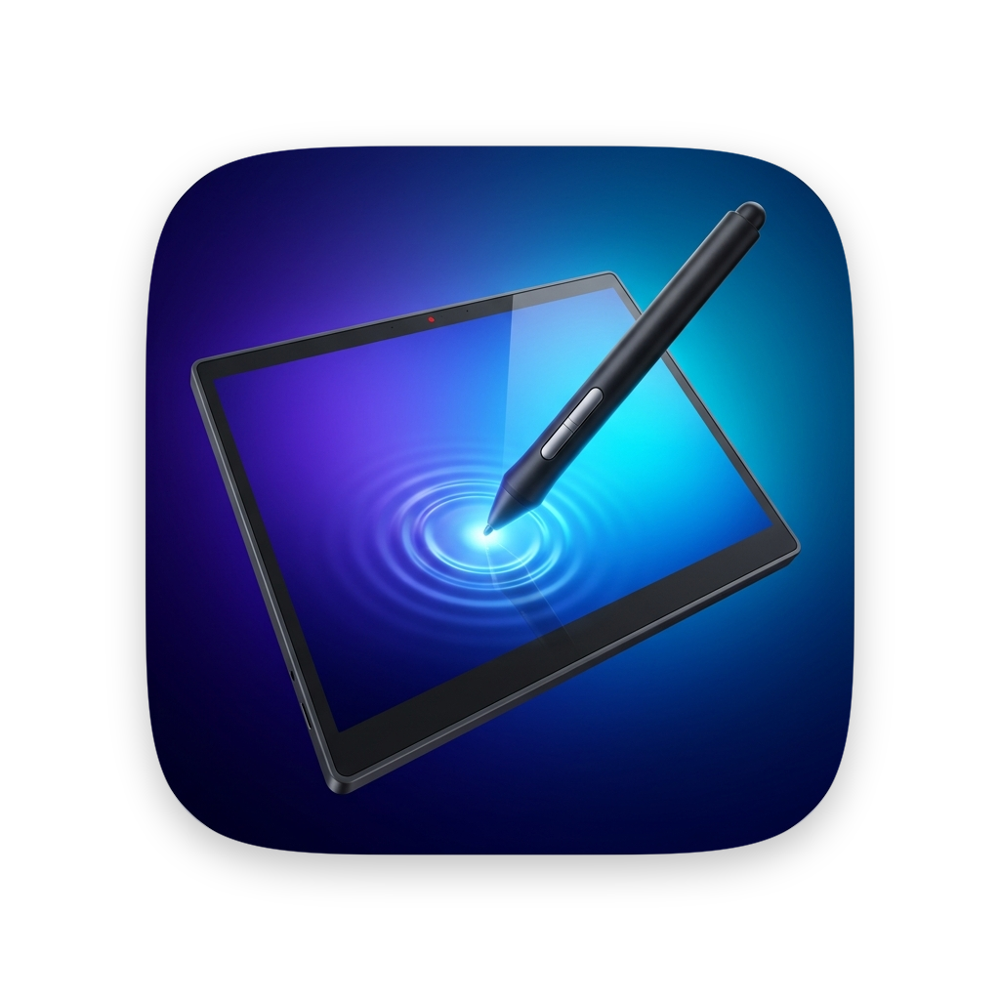
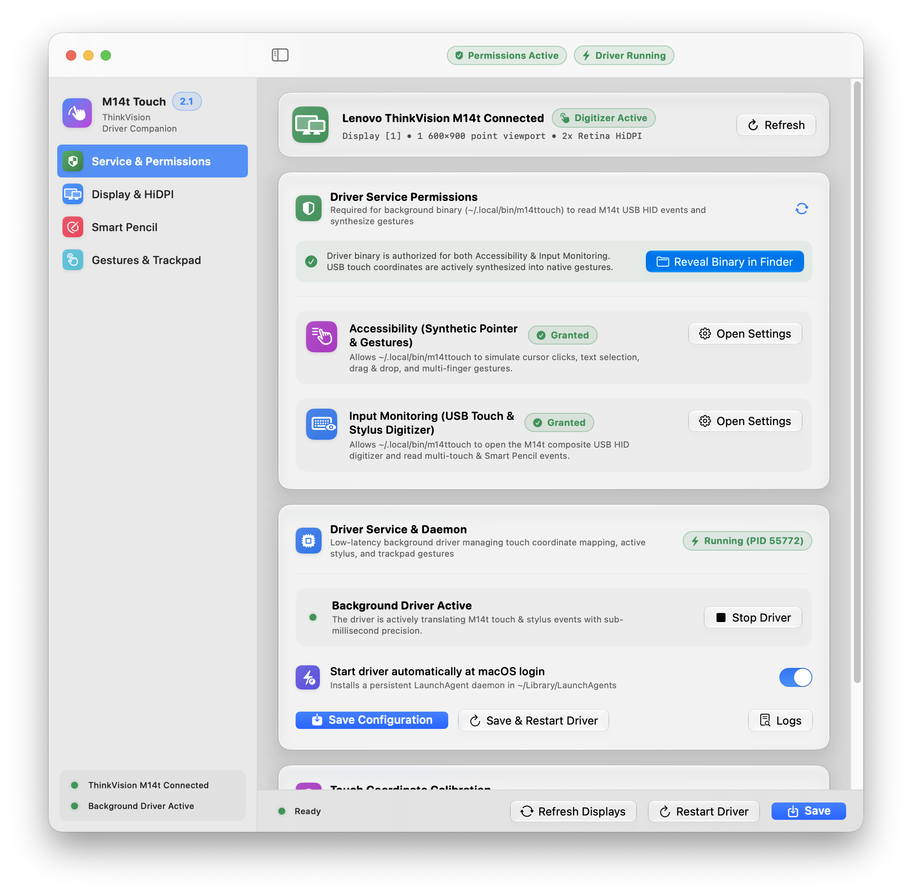
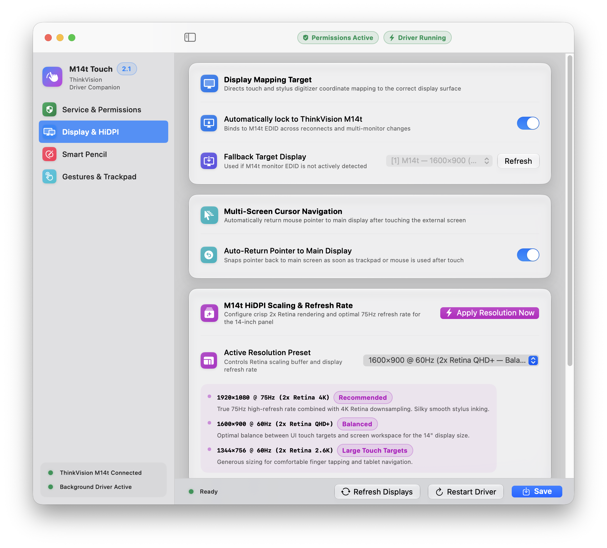
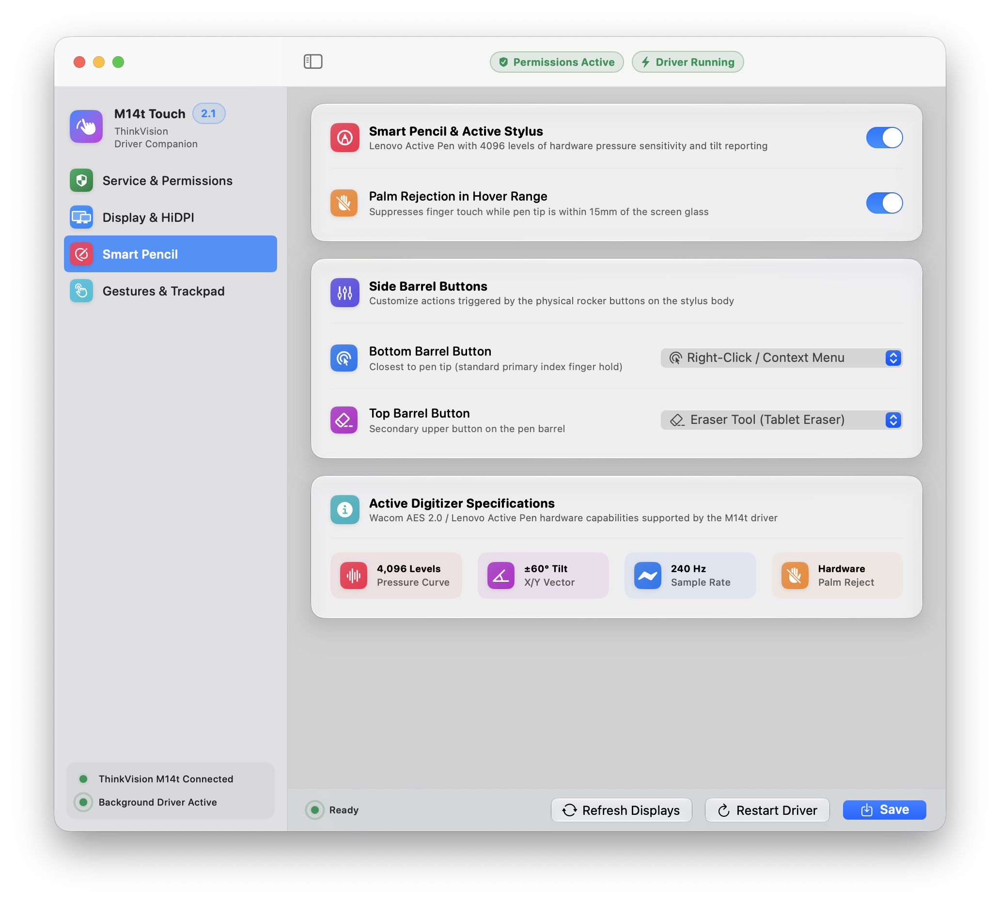
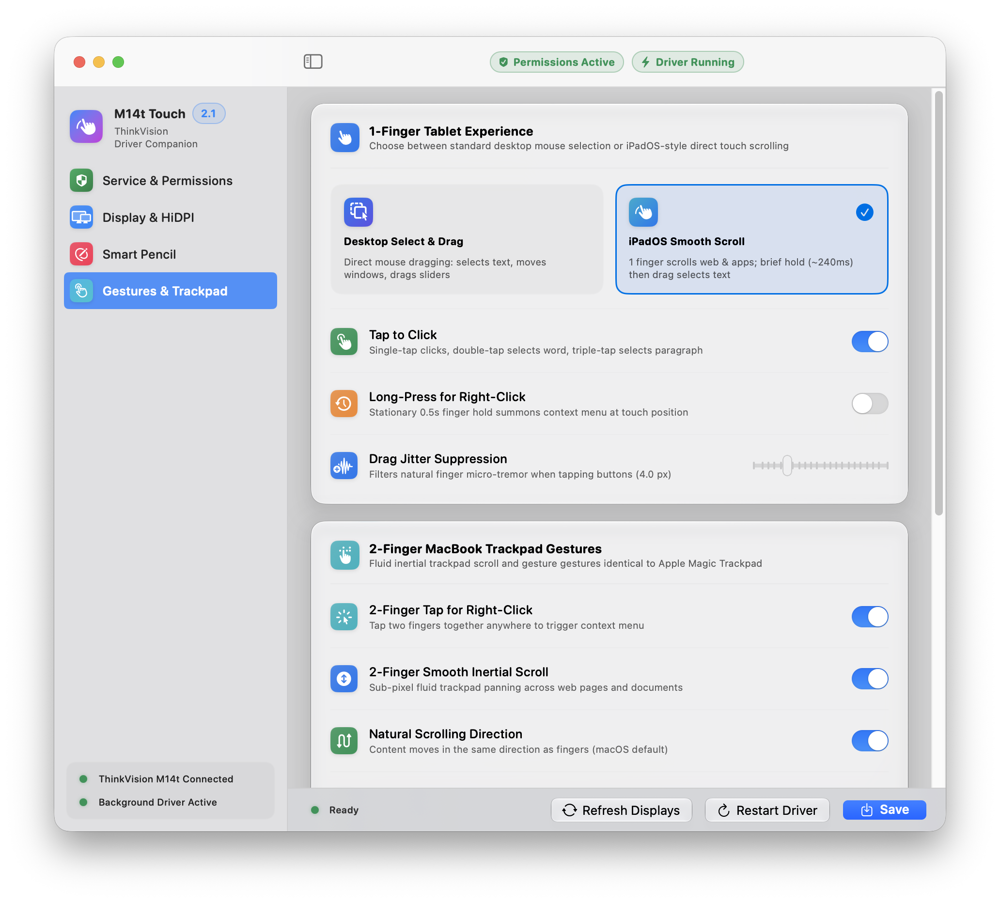

<div align="center">



# M14t Touch for macOS

### Multi-Touch. Smart Pencil. 75Hz Retina HiDPI.
**Compatible with Lenovo's ThinkVision M14t on macOS.**

> ### macOS Installer (v2.1.0)
> **[📦 Download M14tTouch-Installer.pkg](https://raw.githubusercontent.com/talesmousinho/m14t-touch-macos/main/.build/artifacts/M14tTouch-Installer.pkg)**
>
> *Installs both **M14tTouch.app** (`/Applications`) and the **`m14ttouch`** background USB HID driver (`~/.local/bin/m14ttouch`).*

</div>

---

## Why M14t Touch?

Out of the box, macOS recognizes the **Lenovo ThinkVision M14t** video signal over DisplayPort Alt-Mode, but its built-in Wacom multi-touch and Smart Pencil digitizer (`VID 0x2D1F`, `PID 0x524C`) is either ignored or mapped onto the wrong screen (clicking your MacBook's internal display instead of the M14t). It also defaults to standard 1080p 60Hz scaling with soft text and noticeable motion blur.

**M14t Touch** transforms the ThinkVision M14t into a native Apple-grade companion display—delivering sub-millisecond multi-touch, 4,096-level pressure-sensitive Smart Pencil inking, fluid Magic Trackpad gestures, and crisp **2x Retina HiDPI at 75Hz**.

---

## Features

### 1. Service Control & One-Click Permissions

<div align="center">
  
</div>

* **Instant Hardware Detection:** Automatically identifies your Lenovo ThinkVision M14t via its hardware EDID (`0x30AE:0x62A3`) and displays live viewport & Retina HiDPI telemetry.
* **Guided Permission Setup:** Grants the background daemon (`~/.local/bin/m14ttouch`) macOS Accessibility access. Built-in shortcuts reveal the binary in Finder and open System Settings in one click.
* **Persistent LaunchAgent Daemon:** Toggle **Start driver automatically at macOS login** to run silently in the background with zero Dock clutter and sub-millisecond latency.
* **4-Corner Hardware Calibration:** Built-in interactive calibration learns custom bezel bounds if your panel needs edge-to-edge fine-tuning, with instant factory reset (`12372×6960`).

---

### 2. True 2x Retina HiDPI & 75Hz Pro Motion Clarity

<div align="center">
  
</div>

* **Unlocks Hidden 2x Retina HiDPI Modes:** Forces macOS `WindowServer` to render a crisp 4K / QHD+ supersampled framebuffer, eliminating blurry fonts and pixelated UI elements on the 14-inch panel:
  * **`1920×1080 @ 75Hz` (2x Retina 4K — Recommended):** Full HD workspace rendered at `3840×2160` with a 75Hz refresh rate that cuts frame hold time from `16.7ms` to `13.3ms`.
  * **`1600×900 @ 60Hz` (2x Retina QHD+ — Balanced):** Ideal balance between crisp text readability and comfortable touch target sizing.
  * **`1344×756 @ 60Hz` & `1280×720 @ 60Hz` (2x Retina):** Larger UI scaling tailored for effortless finger tapping.
* **Automatic EDID Display Locking:** Locks touch and stylus coordinates exclusively to the M14t—even across sleep/wake cycles, hotplugging, or multi-monitor rearrangement.
* **Auto-Return Pointer to Main Display:** When enabled, touching the M14t moves the cursor to your touch point, and touching your MacBook trackpad or mouse immediately snaps the cursor back to its previous position on your main screen.
* **Axis Orientation Inversion:** Independently mirror horizontal (`X`) or vertical (`Y`) coordinates for inverted or custom stand orientations.

---

### 3. Pro-Grade Smart Pencil & Active Stylus Studio

<div align="center">
  
</div>

* **4,096 Pressure Levels & ±60° X/Y Tilt:** Synthesizes native macOS `CGEvent` tablet pointer and proximity events at **240 Hz**—giving you natural brush weight and shading in **Freeform, Preview, Adobe Photoshop, Illustrator, Concepts, and Blender**.
* **Customizable Dual Barrel Buttons:** Map both physical side buttons on the Lenovo Active Pen to fit your creative workflow:
  * **Bottom Barrel Button:** Defaults to **Right-Click / Context Drag** (configurable to *Tablet Eraser, Middle-Click, Double-Click, Undo `⌘Z`, or Disabled*).
  * **Top Barrel Button:** Defaults to **Native Tablet Eraser** (`NSPointingDeviceType.eraser` — automatically switches drawing and PDF annotation apps to the eraser tool while held).
* **Hardware Hover Palm Rejection:** Automatically suppresses finger multi-touch contacts whenever the Smart Pencil tip enters the 15mm hover range (`InRange = true`), so you can rest your palm naturally on the glass while writing.

---

### 4. Dual-Mode Tablet & Magic Trackpad Gestures

<div align="center">
  
</div>

* **Two Distinct 1-Finger Interaction Modes:**
  * **Desktop Select & Drag:** Direct desktop pointer behavior—1-finger drag selects text, moves windows, and scrubs timelines.
  * **iPadOS Smooth Scroll:** 1-finger drag scrolls web pages and documents naturally; a brief hold (`~240ms`) followed by a drag selects text.
* **Complete Single-Finger Controls:** Single-tap left click, double-tap word selection, triple-tap paragraph selection, stationary 0.5s long-press for right-click, and adjustable **Drag Jitter Suppression** (`1.5px – 12.0px`) for rock-steady taps.
* **2-Finger Magic Trackpad Physics:**
  * **125Hz Sub-Pixel Inertial Scrolling:** Smooth two-finger panning with natural momentum decay.
  * **Native Pinch-to-Zoom:** Synthesizes `NSEvent.EventType.magnify` for fluid zooming in Safari, Chrome, Figma, Maps, Preview, and Photos.
  * **2-Finger Tap:** Instant secondary (right) click anywhere on screen.
* **3 & 4-Finger macOS System Gestures:**
  * **Swipe Left / Right:** Switch seamlessly between macOS **Desktops & Full-Screen Spaces**.
  * **Swipe Up:** Trigger **Mission Control**.
  * **Swipe Down:** Trigger **App Exposé**.

---

## System Requirements

To run **M14t Touch**, make sure your setup meets these requirements:

| Requirement | Specification |
| :--- | :--- |
| **Mac Operating System** | **macOS 13.0 Ventura** or later (macOS 14 Sonoma & macOS 15 Sequoia fully supported) |
| **Processor** | **Apple Silicon** (`M1` / `M2` / `M3` / `M4`) or **Intel** Mac with Thunderbolt / USB-C |
| **Display Hardware** | **Lenovo ThinkVision M14t** (Gen 1 or Gen 2 with Wacom `0x2D1F:0x524C` digitizer) |
| **Connection Cable** | **Full-featured USB-C cable** supporting **DisplayPort Alt-Mode + USB 2.0/3.0 Data**<br>*(⚠️ Charge-only USB-C cables carry power only and will not transmit video or touch data)* |
| **macOS Permissions** | **Accessibility** permission granted once to the background driver (`~/.local/bin/m14ttouch`) |

> [!TIP]
> **Hardware OSD Tip for Zero Ghosting:** Press the physical menu button on the side of your ThinkVision M14t and set **Overdrive** to **Normal**. Avoid *Extreme* (causes inverse white ghost coronas) or *Off* (increases pixel trail smearing).

---

## Installation & First-Time Setup

### Step 1 — Download & Install
1. Download **[M14tTouch-Installer.pkg](https://raw.githubusercontent.com/talesmousinho/m14t-touch-macos/main/.build/artifacts/M14tTouch-Installer.pkg)** and double-click to run the installer.
2. Follow the prompts to install both **M14tTouch.app** (`/Applications/M14tTouch.app`) and the background USB HID driver (`~/.local/bin/m14ttouch`).
3. Open **M14tTouch** from `/Applications`.

> [!NOTE]
> If macOS Gatekeeper prompts that the package or app is from an unidentified developer on first launch, **Right-Click (or Control-Click) `M14tTouch-Installer.pkg` → Open**, or run:
> ```bash
> xattr -cr /Applications/M14tTouch.app ~/.local/bin/m14ttouch
> ```

### Step 2 — Authorize the Background Driver (One-Time Setup)
macOS requires explicit **Accessibility** authorization for the background driver binary (`~/.local/bin/m14ttouch`) to synthesize pointer, stylus, and multi-touch gestures:

1. In **M14t Touch**, open the **Service & Permissions** tab.
2. Click **1. Reveal Binary in Finder** and **2. Open Accessibility Settings**.
3. Drag the highlighted `m14ttouch` binary from Finder directly into **System Settings → Privacy & Security → Accessibility**, and ensure its toggle is switched **ON**.
4. In **M14t Touch**, toggle **Start driver automatically at macOS login** to **ON** and click **Save**.

---

## Command-Line Interface & Building from Source

Prefer building from source or scripting display presets from the terminal? Only **Xcode Command Line Tools** (`swift 5.9+`) are required—zero external dependencies.

```bash
# Clone and install the background daemon + LaunchAgent:
./install.sh --autostart

# Or build standalone artifacts (.app and .pkg):
Scripts/build-app.sh  # -> .build/artifacts/M14tTouch.app
Scripts/build-pkg.sh  # -> .build/artifacts/M14tTouch-Installer.pkg
```

<details>
<summary><strong>View Full CLI Reference (<code>m14ttouch --help</code>)</strong></summary>

```text
DISPLAY & RESOLUTION OPTIONS:
  --display N               Fallback display index if M14t EDID is not found (default: 1)
  --no-auto-display         Disable automatic M14t EDID/name detection and force --display N
  --resolution PRESET       Apply M14t display mode on startup:
                              1920x1080-75hz-hidpi (2x Retina 4K @ 75Hz — Recommended, ultra smooth)
                              1920x1080-60hz-hidpi (2x Retina 4K @ 60Hz — Crisp Full HD)
                              1600x900-hidpi       (2x Retina QHD+ @ 60Hz — Balanced 16:9 UI)
                              1344x756-hidpi       (2x Retina 2.6K @ 60Hz — Comfortable 16:9 UI)
                              1280x720-hidpi       (2x Retina 2.5K @ 60Hz — Large 16:9 UI)
                              1024x576-hidpi       (2x Retina 2K @ 60Hz)
                              960x540-hidpi        (2x Native Retina 1080p @ 60Hz)
                              1920x1080-75hz       (1x Native Full HD @ 75Hz — Max workspace)
                              1920x1080            (1x Native Full HD @ 60Hz)
                              system               (Keep macOS System Setting)
  --set-resolution PRESET   Immediately switch M14t display resolution to PRESET and exit
  --list                    List connected displays (with HiDPI status) and exit
  --list-modes              List all available display modes for the M14t and exit

SMART PENCIL (ACTIVE STYLUS) OPTIONS:
  --barrel-button ACTION    Bottom pen button: right (default), eraser, middle, double, undo, none
  --top-button ACTION       Top pen button: eraser (default), right, middle, double, undo, none
  --no-palm-rejection       Allow finger touch gestures while the Smart Pencil is hovering

TOUCH & TRACKPAD OPTIONS:
  --mode select|scroll      1-finger drag mode: 'select' (default, text selection & window drag)
                            or 'scroll' (iPad-style 1-finger scroll, hold-then-drag to select)
  --auto-return-cursor      Return pointer to main display when trackpad/mouse is used after touch
  --no-auto-return-cursor   Keep pointer on external display after touch
  --no-natural-scroll       Invert 2-finger scroll direction
  --no-natural-spaces       Invert 3/4-finger Desktop swipe direction
  --no-pinch-zoom           Disable 2-finger pinch-to-zoom
  --no-three-finger         Disable 3/4-finger Desktop & Mission Control swipes
  --no-long-press           Disable 1-finger long-press right-click
  --invert-x / --invert-y   Mirror horizontal or vertical axis
  --auto-calibrate          Learn custom raw touch bounds by touching all four corners
  --reset-calibration       Delete saved custom calibration and restore 12372×6960 factory bounds
  --debug                   Print HID frames, Smart Pencil samples, and recognized gestures
  --help, -h                Show help
```

</details>

### Running Tests

```bash
swift test
```

Covers binary decoding of Wacom `0x0C` multi-touch and `0x06`/`0x0B` Smart Pencil packets (including dual barrel buttons and X/Y tilt), multi-display coordinate mapping with rotation, and the 1/2/3/4-finger + Smart Pencil `GestureEngine` state machine.
